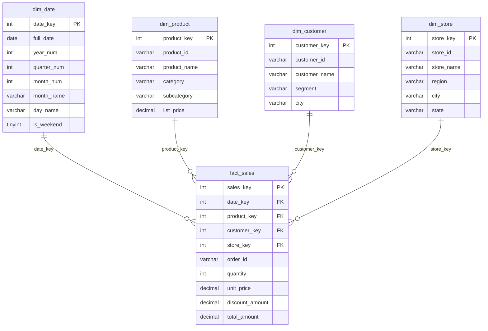

# BrewBox Coffee Roasters – SQL Dimensional Report (DataGrokr Week 5)

A data-warehouse style mini project in **MySQL 8.0+** that models a coffee retailer's sales
as a **star schema** and answers business questions using **window functions, CTEs,
month-over-month analysis, ROLLUP and EXPLAIN-based optimisation**.

## 1. Business Scenario
BrewBox sells coffee beans, ready-to-drink bottles, brewing equipment and accessories through
4 stores (Bengaluru, Mumbai, Delhi, Chennai) to individuals, cafes and corporate customers.
Management wants to know: *what sells, who buys, how is revenue trending, and where are the
subtotals?* Data covers **Jan – Jun 2026** (123 sales lines, 10 customers, 8 products, 4 stores).

## 2. Star Schema



| Table | Type | Grain / Purpose |
|---|---|---|
| `fact_sales` | Fact | One row per product line on an order; measures: quantity, unit_price, discount_amount, total_amount |
| `dim_date` | Dimension | One row per day (year, quarter, month, weekday, weekend flag) |
| `dim_product` | Dimension | Product, category, subcategory, list price |
| `dim_customer` | Dimension | Customer, segment (Corporate / Cafe / Individual), city |
| `dim_store` | Dimension | Store, region (North/South/West), city, state |

`total_amount = quantity × unit_price − discount_amount` (checked: 0 mismatches).

## 3. Files
```
schema.sql          Database, tables, PK/FK, CHECK constraints, indexes
data.sql            Sample data (181 dates, 8 products, 10 customers, 4 stores, 123 sales)
reports.sql         All 5 analytical reports (run in MySQL)
verify_queries.py   Optional: runs everything in SQLite (no MySQL needed) to sanity-check
README.md           This document
```

## 4. How to Run (MySQL Workbench or CLI)
```bash
mysql -u root -p < schema.sql
mysql -u root -p < data.sql
mysql -u root -p < reports.sql
```
Or open the three files in MySQL Workbench and run them in that order.
Requires **MySQL 8.0+** (CTEs, window functions, `GROUPING()`).

## 5. Reports and Results
Sample results below were produced by the included data. MySQL shows money with 2 decimals.

### Report 1 – Star-join view
`vw_sales_detail` joins the fact table with all four dimensions so analysts can query one flat view.

### Report 2 – Window-function rankings
**2.1 Product ranking** (`ROW_NUMBER`, `RANK`, `DENSE_RANK`)

| Product | Category | Units | Revenue (₹) | Rank |
|---|---|---|---|---|
| Arabica Whole Bean 1kg | Coffee Beans | 103 | 120,720.00 | 1 |
| Filter Coffee Powder 500g | Coffee Beans | 133 | 58,387.50 | 2 |
| Robusta Dark Roast 1kg | Coffee Beans | 51 | 44,685.00 | 3 |
| Pour-Over Dripper Set | Equipment | 23 | 39,420.00 | 4 |
| Cold Brew Concentrate 1L | Ready to Drink | 59 | 37,050.00 | 5 |
| Burr Coffee Grinder | Equipment | 8 | 27,125.00 | 6 |
| Ceramic Mug Pack of 4 | Accessories | 28 | 22,080.00 | 7 |
| Reusable Coffee Filters (50) | Accessories | 51 | 14,505.00 | 8 |

No ties in revenue, so the three functions agree. With a tie (e.g. two products at ₹10,000):
`ROW_NUMBER` → 1,2,3 · `RANK` → 1,1,3 · `DENSE_RANK` → 1,1,2.

**2.2 Best product per category** (`RANK() OVER (PARTITION BY category …)`): Arabica Whole Bean (Coffee Beans),
Pour-Over Dripper Set (Equipment), Cold Brew Concentrate (Ready to Drink), Ceramic Mug Pack (Accessories).

**2.3 Customer rank per region** (`DENSE_RANK … PARTITION BY region`), top of each region:
North – Juno Tech Park (₹59,682.50) · South – Aarav Mehta (₹46,770.00) · West – Farhan Sheikh (₹44,805.00).
Note: in South, Farhan Sheikh and Ishita Verma tie at ₹3,500 and both get rank 7.

**2.4 Spend quartiles** (`NTILE(4)`): Q1 = Juno Tech Park, Aarav Mehta, Farhan Sheikh ·
Q4 = Dev Kapoor, Gayatri Rao.

**2.5 Running total with `LAG` / `LEAD`** on daily revenue (first sale day 01-Jan: ₹4,500 → running total ₹4,500; next day's revenue shown via `LEAD`).

### Report 3 – CTE month-over-month growth
Two CTEs: `monthly` (aggregate revenue by month) → `with_prev` (adds previous month using `LAG`) → final SELECT computes change, % and trend.

| Month | Orders | Revenue (₹) | Prev (₹) | MoM change (₹) | MoM % | Trend |
|---|---|---|---|---|---|---|
| January | 14 | 34,150.00 | 0 | 0 | 0 | Baseline |
| February | 17 | 67,070.00 | 34,150.00 | +32,920.00 | +96.40 | Growth |
| March | 22 | 70,080.00 | 67,070.00 | +3,010.00 | +4.49 | Growth |
| April | 16 | 53,690.00 | 70,080.00 | −16,390.00 | −23.39 | Decline |
| May | 25 | 70,455.00 | 53,690.00 | +16,765.00 | +31.23 | Growth |
| June | 29 | 68,527.50 | 70,455.00 | −1,927.50 | −2.74 | Decline |

**Insight:** revenue roughly doubled from January to February, dipped in April, recovered in May, and
June has the most orders (29) but slightly lower revenue than May – a sign of smaller basket sizes.

### Report 4 – ROLLUP (region → category)
`GROUP BY s.region, p.category WITH ROLLUP` produces category rows, a subtotal per region and a grand total.
`GROUPING()` tells subtotal rows apart from real NULLs.

| Region | Units | Revenue (₹) |
|---|---|---|
| North (subtotal) | 143 | 119,975.00 |
| South (subtotal) | 216 | 160,395.00 |
| West (subtotal) | 97 | 83,602.50 |
| **Grand total** | **456** | **363,972.50** |

South is the largest region (~44% of revenue), driven by Coffee Beans (₹1,13,865).

### Report 5 – EXPLAIN and indexing
* **5.1** `EXPLAIN` on the 4-table star join: check `type` (`const`/`eq_ref`/`ref` are good, `ALL` = full scan),
  `key` (index used) and `rows` (estimated rows scanned). Fact FK columns are indexed, so joins use index lookups.
* **5.2** Lookup on `order_id` (not indexed at first): `type = ALL` → full table scan.
  After `CREATE INDEX idx_fact_order ON fact_sales(order_id)` → `type = ref`, `key = idx_fact_order`
  (SQLite check showed `SCAN fact_sales` before and `SEARCH … USING INDEX idx_fact_order` after).
* `EXPLAIN ANALYZE` (MySQL 8.0.18+) gives actual timings.

Why index FK columns? Joins from a large fact table to small dimensions repeat thousands/millions of times;
an index turns each lookup from O(N) scan into O(log N).

## 6. Viva / Interview Quick Notes
1. **Star vs snowflake vs 3NF?** Star = denormalised dimensions around one fact → fewer joins, faster reads for BI. Snowflake normalises dimensions; 3NF is for OLTP.
2. **Fact vs dimension?** Fact = numeric measures at a defined grain; dimension = descriptive context to slice by.
3. **What is the grain here?** One product line per order.
4. **RANK vs DENSE_RANK vs ROW_NUMBER?** Ties: 1,1,3 / 1,1,2 / 1,2,3.
5. **Why CTE?** Named, readable steps (`WITH … AS`); here monthly totals first, then `LAG`.
6. **Window function vs GROUP BY?** GROUP BY collapses rows; window functions keep every row and add a calculation over a "window".
7. **ROLLUP vs CUBE?** ROLLUP = hierarchical subtotals (N+1 levels); CUBE = every combination (2ⁿ). MySQL supports `WITH ROLLUP` only.
8. **What does EXPLAIN show?** Access type, possible/used keys, estimated rows – used to find missing indexes.
9. **Why a smart date key (YYYYMMDD)?** Human-readable, sortable, cheap to join; avoids date-function lookups.
10. **Limitations?** Small sample data, no slowly-changing dimensions, no returns/inventory facts.

## 7. Possible Extensions
Slowly Changing Dimension (Type 2) on `dim_customer`, a returns fact table, a view for a BI dashboard (Power BI / Tableau), stored procedure to load new months.
